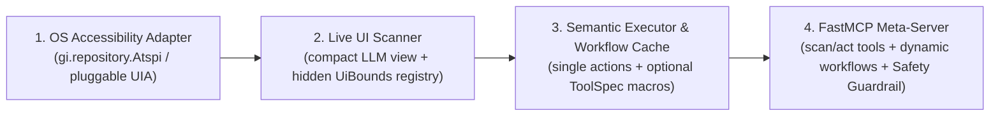

# `jit-mcp` Architecture

`jit-mcp` is a **Dynamic Two-Stage Live-Scan + Semantic-Action MCP** server (licensed under **Apache-2.0**) that inspects live Linux desktop applications via `AT-SPI2`, exposes a compact, token-efficient UI view to LLMs (hiding raw pixel coordinates), executes semantic and coordinate-backed actions safely, and optionally compiles verified multi-step workflows into cached, typed MCP tools.

---

## 1. Dynamic Two-Stage Live-Scan + Semantic-Action Pipeline



### Stage 1: OS Accessibility Adapter (`src/jit_mcp/adapters/`)
- Defines a platform-agnostic `AccessibilityAdapter` protocol (`adapters/base.py`) exposing:
  - `list_apps() -> list[AppInfo]`
  - `get_root(app_id: str) -> UiNode`
  - `get_children(node_ref: str) -> list[UiNode]`
  - `read_node(node_ref: str) -> UiNode`
  - `perform_action(node_ref: str, action: str, value: str | None = None, **kwargs) -> str | None` — supports native semantic actions: `click`, `hover`, `set_text`, `toggle`, `select`, `scroll`.
  - `click_coordinates(cx: int, cy: int) -> None` — coordinate fallback when a semantic node ref drifts.
  - `mouse_path(points: list[tuple[int, int]], button_down: bool = True) -> None` — continuous pointer movement / dragging for canvas drawing and split-pane/divider resizing.
- Ships with `AtSpi2Adapter` (`adapters/atspi2.py`) targeting Linux `gi.repository.Atspi` (PyGObject `Atspi 2.0`) directly:
  - Extracts `name`, `role` (`button`, `dropdown`, `checkbox`, `scrollbar`, `menu_item`, `tab`, `text_input`, `canvas`, etc.), `enabled` (derived from `STATE_SENSITIVE` / `STATE_ENABLED` so greyed-out controls are accurately flagged), `checked`, `expanded`, `value`, and exact screen `UiBounds` (`x, y, width, height, cx, cy`).
  - Implements `click_coordinates` and `mouse_path` via `Atspi.generate_mouse_event` / X11 fallback with **zero `xdotool` dependency**.
  - Runs in a Python virtual environment created with `--system-site-packages` so system `gi.repository.Atspi` is available without compiling PyGObject from source, and checks `org.gnome.desktop.interface toolkit-accessibility` on startup (emitting an actionable warning if disabled).
- Because downstream stages depend only on `AccessibilityAdapter`, a future Windows UI Automation (`WindowsUiaAdapter`) or macOS AX adapter plugs in without modifying the scanner, executor, compiler, or server.

### Stage 2: Live UI Scanner (`src/jit_mcp/scanner.py`)
- Actively scans the live application's accessibility tree under strict resource budgets (`max_depth`, `max_nodes`, `timeout_ms`) — no blind recursive clicking.
- **Flattened Menu Paths & Shortcut Extraction**: Scans menu trees up to configured depth and emits flattened `menu_path` entries (e.g., `File > Save`, `File > Export As > Export as PDF`) alongside extracted `AT-SPI2` keyboard `shortcut` hints (e.g., `Ctrl+S`) in a single scan, eliminating slow 1-click-per-LLM-turn menu diving.
- Produces **two distinct views** in `ScanResult`:
  1. **LLM-Facing Compact View** (token-efficient, **strictly hides raw pixel coordinates**): lists each discovered control's `control_id`, `name`, `role`, `enabled` (greyed-out status), `menu_path` / `shortcut` (when present), and relevant states (`checked`, `expanded`, `value`).
  2. **Internal Control Registry** (in-memory / cached per app): maps `control_id` and `name` -> live `node_ref` + exact `UiBounds` (`x, y, width, height, cx, cy`) + `menu_path`.
- Computes a deterministic `snapshot_hash` for provenance and change detection across re-scans.

### Stage 3: Semantic Executor, Workflow Compiler & Cache (`executor.py`, `compiler.py`, `cache.py`, `safety.py`)
- **Executor (`executor.py`)**:
  - Executes single semantic actions by `control_id` or `name` (falling back to the hidden internal `UiBounds` coordinates if the live `node_ref` drifts), automatically expanding parent menus along `menu_path` when clicking nested menu items.
  - **Greyed-Out Enforcement**: Refuses to click or interact with disabled controls (`enabled=False`) and returns a clear, actionable error telling the caller why the control is unavailable.
  - **Latency Optimizations**:
    - **Action Batching (`execute_action_batch`)**: Executes a multi-step action sequence (e.g., `set_text` -> `toggle_checkbox` -> `click_control`) in a single MCP call with `stop_on_error=True`, halting early on error or whenever a `confirm` / `blocked` Safety Guardrail triggers.
    - **Direct Keyboard Shortcuts (`press_shortcut`)**: Dispatches extracted shortcuts (e.g., `"Ctrl+S"`) directly to bypass multi-step menu navigation.
  - Supports `click`, `hover`, `set_text`, `toggle`, `select`, `scroll`, `press_shortcut`, and `draw_path` (converting normalized `0.0-1.0` waypoints inside a target control's `UiBounds` — or raw pixel waypoints — into `mouse_path` calls for canvas drawing and split-pane/divider dragging).
  - Also executes multi-step cached `ToolSpec` workflows deterministically, interpolating arguments safely without template injection and verifying all `postconditions`.
- **Workflow Compiler (`compiler.py`)**: Defines a pluggable `CompilerBackend` protocol (`HeuristicCompilerBackend` default for offline zero-cost runs + optional `LlmCompilerBackend`) to save/compile **verified multi-step workflows** into reusable macro `ToolSpec`s (`tool_spec.json` v1.0.0) with semantic selectors and `coordinate_fallback`.
- **Cache (`cache.py`)**: Validates every `ToolSpec` against the `tool_spec.json` v1.0.0 schema and persists it to disk (`$JIT_MCP_CACHE_DIR` or `~/.cache/jit-mcp/<app_id>/<tool_name>.json`).

### Stage 4: FastMCP Meta-Server & Safety Guardrail (`server.py`, `safety.py`)
- **Core Live-Scan & Semantic-Action Tools** (always registered, token-efficient):
  - `list_desktop_apps()`
  - `scan_app_ui(app_id)` — returns the compact LLM view (including flattened `menu_path` and `shortcut` hints) **without** raw pixel coordinates
  - `click_control(app_id, control_id_or_name, confirmed=False)` — auto-expands parent menus along `menu_path` if needed
  - `hover_control(app_id, control_id_or_name)`
  - `set_text(app_id, control_id_or_name, text)`
  - `toggle_checkbox(app_id, control_id_or_name)`
  - `select_dropdown(app_id, control_id_or_name, option)`
  - `scroll_control(app_id, control_id_or_name, direction, amount)`
  - `draw_or_drag_path(app_id, control_id_or_name, points, normalized=True, button_down=True)`
  - `press_shortcut(app_id, shortcut)` — direct keyboard shortcut execution (e.g., `"Ctrl+S"`)
  - `execute_action_batch(app_id, actions, stop_on_error=True)` — multi-step action sequence in one MCP call, halting early on error or `confirm` guardrail trigger
- **Workflow Caching & Dynamic Tool Registration**:
  - `save_workflow_tool(...)` — compiles and caches a verified multi-step workflow as a `ToolSpec`, dynamically registers it on the FastMCP server, and emits `notifications/tools/list_changed`.
  - `call_compiled_tool(app_id, tool_name, arguments, confirmed=False)` — proxy fallback for MCP clients that do not support dynamic `notifications/tools/list_changed` refresh.
- **Safety Guardrail (`safety.py`)**: Classifies controls, actions, and workflow tools into three risk tiers:
  - `safe`: Read-only or non-destructive actions; executes immediately.
  - `confirm`: Potentially destructive actions (e.g., delete, remove, overwrite, send, submit payment, close without saving); requires explicit `confirmed=True` before execution.
  - `blocked`: Prohibited high-risk actions (e.g., disk format, credential export, system shutdown); always rejected.

---

## 2. Strict Permissive Open-Source License Policy

- **Project License**: `jit-mcp` is licensed under **Apache-2.0** (root `LICENSE` file).
- **Python Dependencies**: All direct and dev Python package dependencies MUST use permissive, commercial-friendly open-source licenses only (**MIT, Apache-2.0, BSD, ISC**):
  - Runtime: `mcp` (MIT), `pydantic` (MIT), `jsonschema` (MIT)
  - Dev/Test: `pytest` (MIT), `ruff` (MIT)
- **System Accessibility Binding**: On Linux, `gi.repository.Atspi` (PyGObject / AT-SPI2) is dynamically linked as a system library under **LGPL-2.1+**, which is compatible with commercial use of an Apache-2.0 Python package.
- **Prohibited**: GPL or AGPL Python package dependencies are strictly forbidden.

---

## 3. Directory & File Layout

Every module is intentionally small and single-purpose so parallel workers can implement work items without editing the same files.

```text
jit-mcp/
├── LICENSE                         # Apache-2.0 license
├── pyproject.toml                  # Package metadata, Apache-2.0 license, permissive deps, CLI (`jit-mcp`)
├── README.md                       # Simple, jargon-free overview and 60-second setup
├── docs/
│   ├── quickstart.md               # Step-by-step user guide (install, connect, first scan & action)
│   ├── architecture.md             # This document
│   └── rtc/
│       ├── dod.md                  # Global Definition of Done checklist (incl. license compliance)
│       ├── work_items.csv          # Non-overlapping file-level Work Items (WI-001..WI-014)
│       ├── defects.csv             # Defect tracker
│       └── test_cases/             # Given/When/Then test specifications (L1, L2, L3)
├── src/
│   └── jit_mcp/
│       ├── __init__.py             # Package version and public exports
│       ├── models.py               # Pydantic models: AppInfo, UiBounds, UiNode, ScanResult, ToolSpec, etc.
│       ├── adapters/
│       │   ├── __init__.py         # Adapter exports
│       │   ├── base.py             # AccessibilityAdapter protocol, mouse_path & exceptions
│       │   └── atspi2.py           # Linux gi.repository.Atspi adapter + Atspi/X11 mouse fallback
│       ├── scanner.py              # Live UI Scanner (budgets, compact LLM view, hidden UiBounds registry)
│       ├── safety.py               # Safety Guardrail (risk tiering, destructive-action checks)
│       ├── cache.py                # Disk cache & JSON Schema validation for tool_spec.json
│       ├── compiler.py             # Pluggable CompilerBackend for verified multi-step workflow ToolSpecs
│       ├── executor.py             # Semantic + coordinate fallback executor, enabled guard, draw_path
│       └── server.py               # FastMCP Meta-Server, live-scan/action tools, dynamic workflows, CLI
└── tests/
    ├── conftest.py                 # Shared fake AccessibilityAdapter, sample apps, temp cache
    ├── unit/                       # Level 1: isolated per-module unit tests (WI-012)
    ├── component/                  # Level 2: multi-module pipeline & server integration tests (WI-013)
    └── e2e/                        # Level 3: full MCP lifecycle + live X11/AT-SPI2 GTK3 smoke test (WI-014)
```

---

## 4. Cached Workflow Tool Schema (`tool_spec.json`)

Each compiled multi-step workflow tool is stored as a single JSON file conforming to schema version `1.0.0`:

```json
{
  "$schema": "https://json-schema.org/draft/2020-12/schema",
  "$id": "https://jit-mcp.local/schemas/tool_spec.v1.json",
  "title": "JitMcpToolSpec",
  "type": "object",
  "required": [
    "schema_version",
    "app",
    "tool",
    "steps",
    "postconditions",
    "safety",
    "provenance"
  ],
  "additionalProperties": false,
  "properties": {
    "schema_version": {
      "type": "string",
      "const": "1.0.0"
    },
    "app": {
      "type": "object",
      "required": ["name", "app_id", "platform"],
      "additionalProperties": false,
      "properties": {
        "name": { "type": "string", "minLength": 1 },
        "app_id": { "type": "string", "minLength": 1 },
        "version": { "type": "string" },
        "platform": { "type": "string", "enum": ["linux-atspi2", "windows-uia", "macos-ax"] },
        "toolkit": { "type": "string" }
      }
    },
    "tool": {
      "type": "object",
      "required": ["name", "description", "parameters"],
      "additionalProperties": false,
      "properties": {
        "name": { "type": "string", "pattern": "^[a-z][a-z0-9_]{1,63}$" },
        "description": { "type": "string", "minLength": 1 },
        "parameters": {
          "type": "object",
          "required": ["type", "properties"],
          "properties": {
            "type": { "const": "object" },
            "properties": { "type": "object" },
            "required": {
              "type": "array",
              "items": { "type": "string" }
            },
            "additionalProperties": { "type": "boolean" }
          }
        }
      }
    },
    "steps": {
      "type": "array",
      "minItems": 1,
      "items": {
        "type": "object",
        "required": ["step_id", "action", "target"],
        "additionalProperties": false,
        "properties": {
          "step_id": { "type": "string", "minLength": 1 },
          "action": {
            "type": "string",
            "enum": ["click", "hover", "set_text", "select", "toggle", "scroll", "draw_path", "key_press", "read_text", "wait"]
          },
          "target": { "$ref": "#/$defs/selector" },
          "fallbacks": {
            "type": "array",
            "items": { "$ref": "#/$defs/selector" },
            "default": []
          },
          "coordinate_fallback": {
            "oneOf": [
              { "$ref": "#/$defs/bounds" },
              { "type": "null" }
            ]
          },
          "value_template": { "type": ["string", "null"] },
          "timeout_ms": { "type": "integer", "minimum": 100, "maximum": 30000, "default": 3000 }
        }
      }
    },
    "postconditions": {
      "type": "array",
      "items": {
        "type": "object",
        "required": ["type", "target"],
        "additionalProperties": false,
        "properties": {
          "type": {
            "type": "string",
            "enum": ["element_exists", "element_absent", "text_contains", "state_equals", "value_equals"]
          },
          "target": { "$ref": "#/$defs/selector" },
          "expected": { "type": ["string", "boolean", "null"] },
          "timeout_ms": { "type": "integer", "minimum": 100, "maximum": 15000, "default": 2000 }
        }
      }
    },
    "safety": {
      "type": "object",
      "required": ["risk_tier", "requires_confirmation", "reason"],
      "additionalProperties": false,
      "properties": {
        "risk_tier": { "type": "string", "enum": ["safe", "confirm", "blocked"] },
        "requires_confirmation": { "type": "boolean" },
        "reason": { "type": "string" }
      }
    },
    "provenance": {
      "type": "object",
      "required": ["compiled_at", "intent", "scanner_budget", "snapshot_hash", "compiler_version"],
      "additionalProperties": false,
      "properties": {
        "compiled_at": { "type": "string", "format": "date-time" },
        "intent": { "type": "string" },
        "scanner_budget": {
          "type": "object",
          "required": ["max_depth", "max_nodes", "timeout_ms"],
          "properties": {
            "max_depth": { "type": "integer", "minimum": 1 },
            "max_nodes": { "type": "integer", "minimum": 1 },
            "timeout_ms": { "type": "integer", "minimum": 100 }
          }
        },
        "snapshot_hash": { "type": "string", "minLength": 8 },
        "compiler_version": { "type": "string" }
      }
    }
  },
  "$defs": {
    "selector": {
      "type": "object",
      "required": ["role"],
      "additionalProperties": false,
      "properties": {
        "role": { "type": "string", "minLength": 1 },
        "name": { "type": ["string", "null"] },
        "name_pattern": { "type": ["string", "null"] },
        "automation_id": { "type": ["string", "null"] },
        "path_hint": { "type": ["string", "null"] }
      }
    },
    "bounds": {
      "type": "object",
      "required": ["x", "y", "width", "height", "cx", "cy"],
      "additionalProperties": false,
      "properties": {
        "x": { "type": "integer" },
        "y": { "type": "integer" },
        "width": { "type": "integer", "minimum": 0 },
        "height": { "type": "integer", "minimum": 0 },
        "cx": { "type": "integer" },
        "cy": { "type": "integer" }
      }
    }
  }
}
```

---

## 5. Simple Human-Facing UX

End users should never need to know about `AT-SPI2`, accessibility trees, or internal RTC artifacts:
- **`README.md`**: Plain-language 3-sentence summary ("Control any Linux desktop app from your AI assistant — scan live controls, click/type/draw safely, and save repeatable workflows as MCP tools"), quick install command, copy-paste MCP client config snippet, and a 3-step example.
- **`docs/quickstart.md`**: Task-oriented 60-second walkthrough:
  1. Install `jit-mcp`.
  2. Add `jit-mcp` to your MCP client.
  3. Ask your assistant to list apps, scan an app's UI, perform actions (or save a workflow), plus a short note on how safety confirmations work for destructive actions.

---

## 6. Verification Strategy: 3-Level Test Pyramid & Blind Usability Test

1. **Level 1 — File / Unit Tests (`tests/unit/`, `WI-012`)**:
   - Fast, isolated tests for each module (`models`, `atspi2` adapter wrapper, `scanner` two-view output + hidden coordinates + budgets, `safety`, `cache`, `compiler` heuristic backend, `executor` greyed-out guard + semantic/coordinate fallback + `draw_path`, and license compliance).
   - Zero live desktop or GUI dependencies; uses deterministic in-memory fixtures.
2. **Level 2 — Subpart / Component Tests (`tests/component/`, `WI-013`)**:
   - Tests multi-module interactions: Scanner -> Executor -> Safety Guardrail -> Workflow Compiler -> Cache using a realistic fake `AccessibilityAdapter`, plus FastMCP server live-scan/action tools, dynamic workflow registration, and `notifications/tools/list_changed`.
3. **Level 3 — End-to-End Tests (`tests/e2e/`, `WI-014`)**:
   - Exercises the full `jit-mcp` server lifecycle through the MCP protocol (`list_desktop_apps` -> `scan_app_ui` -> semantic/coordinate actions -> `save_workflow_tool` & `call_compiled_tool` -> cache hit -> destructive-action guardrail confirmation/blocking), plus a live Linux X11 `AT-SPI2` ground-truth smoke test against a lightweight GTK3 test window.
4. **Dev-App vs. Holdout-App Generalization Split**:
   - **Internal Dev / Verification Targets**: Deterministic live GTK3 ground-truth test window + **LibreOffice Writer** (`/usr/bin/libreoffice`).
   - **Holdout / Adversarial / Blind Usability Targets**: An unseen desktop app NOT used by implementation builders (e.g., **LibreOffice Calc** or a newly installed app such as **Mousepad / Galculator / GIMP**) reserved strictly for the Red-Team adversarial check and blind `claude-sonnet-5-5-low` docs-only usability test to prove zero overfitting.
5. **Blind Docs-Only Usability Test (`claude-sonnet-5-5-low`)**:
   - After all automated tests pass, a fresh `claude-sonnet-5-5-low` agent with access **only** to `README.md` and `docs/quickstart.md` (no `src/` or `docs/architecture.md`) attempts to install, configure, and use `jit-mcp` against a holdout app. Any confusion, missing prerequisite, or jargon surfaced by the blind test is logged as a defect and fixed before release.
